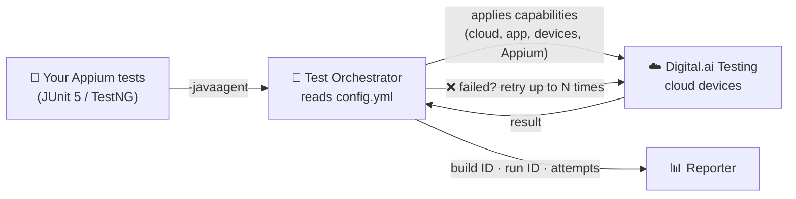
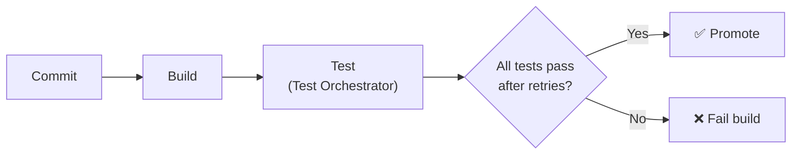

<div align="center">

# Digital.ai Test Orchestrator

**Smarter, more efficient test execution for your Appium tests: automatic retries, faster feedback on critical tests, and insight into unreliable tests, without changing your existing tests.**


[What it is](#-what-is-test-orchestrator) •
[Quick start](#-quick-start) •
[Configuration](#%EF%B8%8F-configuration-reference) •
[Features](#-features-in-detail) •
[CI/CD](#-cicd-integration) •
[Troubleshooting](#-troubleshooting)

</div>

---

## 🧭 What is Test Orchestrator?

Test Orchestrator sits between your Appium tests and the **Digital.ai Testing** platform. It introduces a smarter way to manage test execution: it automatically retries failed tests, gives faster feedback on critical tests, and helps identify unreliable tests. Combined with MCP, it also extends AI-driven testing workflows with smarter execution management, without the need to change your existing tests.

The goal is simple: less time managing test runs, faster feedback, and greater confidence in your releases.

> **The short version:** Your team already has Appium tests running on Digital.ai Testing. Test Orchestrator helps manage how those tests run, without changing the tests themselves.

### Why it exists

As test automation grows, you end up with a mountain of scripts, and AI helps teams create even more. When it's time for regression testing, the tests that are meant to give you confidence can fail for reasons that aren't obvious.

The challenge isn't just running more tests. It's managing how those tests run, knowing which failures need attention, and getting the right feedback at the right time. That's what Test Orchestrator is for.

### What it is, in one table

| | |
|---|---|
| 📦 **A Java agent** | A single JAR, attached to your existing test run with `-javaagent`. No SDK to code against. |
| 🔁 **Automatic retries** | Failed tests are rerun up to *N* times, to help tell temporary failures from repeatable defects. Every attempt is visible in Reporter. |
| ⚡ **Faster feedback on critical tests** | Get notified of critical test failures sooner, without waiting for the entire run to finish (fail fast). |
| 🔎 **Unreliable test identification** | Spot tests that fail inconsistently, so you know where to focus debugging and how to improve automation reliability. |
| 🤖 **AI-driven workflows** | Combined with MCP, extends AI-driven testing workflows with smarter execution management. |
| 📝 **One YAML file** | Defines how tests execute: cloud connection, app, device selection, retries, and which tests to run. Configuration-based adoption, no changes to your existing tests. |
| 🎯 **Test selection** | Run one class or one method from config. You don't need to edit test suites or build files. |


### How it works



Test Orchestrator runs as a **JVM agent**. At runtime it hooks into the test runner (JUnit / TestNG) and the Appium driver.

---

## ✅ Prerequisites

| Requirement | Supported                                                                                                                                      |
|---|------------------------------------------------------------------------------------------------------------------------------------------------|
| **Java** | 17 or 21                                                                                                                                       |
| **Build tool** | Gradle or Maven                                                                                                                                |
| **Test framework** | JUnit 5 (Jupiter) or TestNG 7+                                                                                                                 |
| **Appium Java client** | 8, 9 or 10                                                                                                                                     |
| **Digital.ai Testing** | A cloud URL and an [access key](https://docs.digital.ai/continuous-testing/docs/te/test-execution-home/getting-started/obtain-your-access-key) |
| **Test Orchestrator JAR** | Ask your Digital.ai representative or the [Support Team](https://support.digital.ai/hc/en-us)                                                                                     |

---

## 📁 What's in this repo

```
.
├── lib/
│   ├── smart-agent-1.0-SNAPSHOT.jar   ← the Test Orchestrator agent
│   ├── config.yml                     ← THE config file: the agent reads this one
│   └── config.example.yml             ← annotated example with more options
├── src/test/java/tests/
│   ├── LoginScenariosTest.java        ← 2 example tests
│   └── PaymentScenariosTest.java      ← 2 example tests
├── build.gradle.kts                   ← attaches the agent to the `test` task
└── smart-agent/<run-id>/              ← generated: one log folder per run
```

> 💡 **The example tests are flaky on purpose to demonstrate how the Test Orchestrator handles flakiness.**

---

## 🚀 Quick start

### 1. Clone the repo

```bash
git clone https://github.com/raheekhandigitalai/Digital.ai-Testing-Test-Orchestrator.git
cd Digital.ai-Testing-Test-Orchestrator
```

### 2. Add your cloud details to `lib/config.yml`

`lib/config.yml` is the main configuration file. Test Orchestrator reads it on every run. Fill in your cloud URL and access key:

```yaml
cloud:
  url: https://<YOUR_CLOUD_HOST>/wd/hub
  accessKey: <YOUR_ACCESS_KEY>
```

> 📖 **Need more than the basics?** [`lib/config.example.yml`](lib/config.example.yml) is an annotated example. It shows how to set up Android, pin app versions, use device pools, select tests and configure fail fast. Copy across whatever you need.

### 3. Attach the agent (already done in this repo)

The only build change you need is one JVM argument on the test task. It takes the form `-javaagent:<agent.jar>=<config.yml>`:

```kotlin
// build.gradle.kts
tasks.test {
    jvmArgs(
        "-javaagent:${projectDir}/lib/smart-agent-1.0-SNAPSHOT.jar=${projectDir}/lib/config.yml",
        "-Dbuild.id=${System.getenv("BUILD_ID") ?: "local"}"
    )
    useTestNG()
}
```

> 🧪 **This repo uses TestNG.** Using **JUnit 5** instead? The agent setup is the same: swap `useTestNG()` for `useJUnitPlatform()` and add the JUnit dependencies.
> 
> [Here's how to set it up for JUnit in the docs →](https://docs.digital.ai/continuous-testing/docs/te/test-execution-home/smart-agent#step-5-update-your-gradle-test-task)
>
> 📦 **Using Maven instead of Gradle?** You attach the agent the same way, through the Surefire plugin. 
>
> [See the Maven example below →](#maven-setup)

### 4. Run your tests the way you always do

```bash
./gradlew test
```

### 5. Check the results in Reporter

Open **Reporter** in Digital.ai Testing and filter by your **Build ID**. A test that fails now shows every attempt. Because the example tests are random, your results will differ, but they will look something like this:

```text
negative_payment_test    Attempt 1 ❌  →  Attempt 2 ✅                   ⇒ failed once, passed on retry
positive_payment_test    Attempt 1 ✅                                   ⇒ passed, no retry needed
positive_login_test      Attempt 1 ❌  →  Attempt 2 ❌  →  Attempt 3 ❌   ⇒ failed every attempt (possible with random tests, but less likely)
```

When a test fails and then passes on a retry, there's a good chance the failure came from something other than your app, like the environment, the network or timing. When it fails on every attempt, that's a stronger signal of a real problem. Either way, the attempts in Reporter give you a clearer place to start, not a final verdict.

---

## ⚙️ Configuration reference

Everything is controlled from `config.yml`. Change the app version, the devices, the retries or the tests to run **without touching your test methods.**

### 🧩 Capabilities in code vs. YAML

**You don't have to remove capabilities from your existing tests.** The rule is simple:

> **If `config.yml` sets it, `config.yml` wins. If `config.yml` doesn't set it, your test code is used.**

**Example.** Your test already sets a device query and an app:

```java
dc.setCapability("digitalai:deviceQuery", "@os='ios' and @version='17.0'");
dc.setCapability("appium:app", "cloud:com.experitest.ExperiBank");
```

Your `config.yml` sets **only** the device query:

```yaml
deviceQuery:
  iosQuery:
    deviceQuery: "@os='ios' and @version>='18.0'"
```

When the test runs, it uses:

| Capability | Value used | Why |
|---|---|---|
| Device query | `@os='ios' and @version>='18.0'` | Set in `config.yml`, so it **overrides** the code |
| App | `cloud:com.experitest.ExperiBank` | Not set in `config.yml`, so the **code value** is kept |

This means you can adopt Test Orchestrator without touching your test methods. To change a value for every test, change it once in `config.yml`.

```yaml
# ─── Where to run ──────────────────────────────────────────────
cloud:
  url: https://<YOUR_CLOUD_HOST>/wd/hub        # Required
  accessKey: <YOUR_ACCESS_KEY>            # Required

# ─── What to test ──────────────────────────────────────────────
app:
  ios:
    app: cloud:com.experitest.ExperiBank  # App already uploaded to the cloud
    bundleID: com.experitest.ExperiBank
    # appBuildVersion:                    # Optional: pin a build
    # appReleaseVersion:                  # Optional: pin a release
  # android:
  #   app: cloud:com.experitest.ExperiBank/.LoginActivity
  #   packageName: com.experitest.ExperiBank
  #   activity: .LoginActivity
  #   appBuildVersion:
  #   appReleaseVersion:

# ─── Which devices ─────────────────────────────────────────────
deviceQuery:
  iosQuery:
    deviceQuery: "@os='ios'"              # e.g. "@os='ios' and @version>='18.0'"
  # androidQuery:
  #   deviceQuery: "@os='android' and @category='PHONE'"
  # devicePool: SHARED

# ─── Appium server version ─────────────────────────────────────
appium:
  appiumVersion: 3.5.2

# ─── How to run ────────────────────────────────────────────────
run:
  maxRetryAttempts: 2                     # Retries per failed test (default: 0)
  testSelection:                          # Empty = run everything
    # - tests.LoginScenariosTest                         # a whole class
    # - tests.PaymentScenariosTest#negative_payment_test  # a single method
  # criticalTests:                        # Fail fast (see below)
  #   - tests.LoginScenariosTest#positive_login_test
```

### Key-by-key

| Key | Required | What it does |
|---|:---:|---|
| `cloud.url` | ✅ | Your Digital.ai Testing Appium endpoint. |
| `cloud.accessKey` | ✅ | Your access key for authentication. |
| `app.ios.app` / `app.android.app` | | The app to install, using `cloud:<bundleId>` or `cloud:<uniqueName>`. |
| `app.ios.bundleID` / `app.android.packageName` | | The app identifier. |
| `app.android.activity` | | The launch activity, e.g. `.LoginActivity`. |
| `app.*.appBuildVersion` / `appReleaseVersion` | | Pins a specific uploaded version of the app. |
| `deviceQuery.iosQuery.deviceQuery` / `androidQuery.deviceQuery` | | A device query in the standard Digital.ai query syntax. |
| `deviceQuery.devicePool` | | The device pool to use, e.g. `SHARED`. |
| `appium.appiumVersion` | | The Appium **server** version used in the cloud. |
| `run.maxRetryAttempts` | | How many times a **failed** test is retried. Default is `0`. |
| `run.testSelection` | | Classes (`ClassName`) or methods (`ClassName#method`) to run. Leave empty to run all tests. |
| `run.criticalTests` | | Methods that trigger [fail fast](#-fail-fast-for-critical-tests) when they fail. |

> ⚠️ **YAML is sensitive to indentation.** Use spaces, not tabs. If a run behaves unexpectedly, validate the file first.

---

## 🔍 Features in detail

### 🔁 Automatic retries

Set `run.maxRetryAttempts`. Test Orchestrator **only retries tests that fail**, which helps distinguish temporary failures from repeatable defects without anyone rerunning a build by hand. Tests that pass run once. Every attempt is reported separately, so you can see the full history of each test in one place.

| Pattern in Reporter | What it may indicate |
|---|---|
| ❌ → ✅ | **Possibly flaky.** There's a good chance the failure came from the environment, the network or timing, rather than a defect in your app. Worth a look, especially if it keeps happening. |
| ❌ → ❌ → ❌ | **Consistent failure.** A stronger signal of a real problem, in the app or in the test itself. A good place to start debugging. |

### 🔎 Identifying unreliable tests

Because every attempt is reported and each test keeps a **Test Case ID**, you can see which tests fail inconsistently across attempts and across runs. Filter by Test Case ID in Reporter to see how stable a test has been over time, so your team can focus its debugging effort and improve automation reliability.

### 🎯 Selective test execution

Run part of your suite without editing TestNG XML files, JUnit tags or build scripts:

```yaml
run:
  testSelection:
    - tests.LoginScenariosTest                          # whole class
    - tests.PaymentScenariosTest#negative_payment_test   # single method
```

### 🛑 Fail fast for critical tests

Get feedback on critical test failures sooner, without waiting for the entire run to finish. When a critical test fails (for example, login), the tests after it will usually fail too. Fail fast stops those cascading failures:

```yaml
run:
  criticalTests:
    - tests.LoginScenariosTest#positive_login_test   # must be Class#method; whole classes aren't supported
```

When a critical test **still fails after all its retries**, Test Orchestrator:

1. Lets the tests that are already running finish.
2. Stops starting new tests.
3. Marks the remaining tests as **Skipped**, with the reason *"Skipped due to critical test failure: &lt;TestCaseID&gt;"*.

Skipped tests are never retried, and they have no steps, video or logs. Tests that already finished keep their status.

### 🔄 Test status sync (automatic)

Sometimes the Appium session status and your framework's result disagree. For example, an assertion fails after the session ends, or a driver exception is caught on purpose. Test Orchestrator makes the **Reporter status match what JUnit/TestNG reported**. This needs no configuration.

### 🏷️ Build ID & Run ID

| ID | Scope | Where it comes from |
|---|---|---|
| **Build ID** | Every test in one CI/CD build | You set it with `-Dbuild.id=<value>` |
| **Run ID** | One Test Orchestrator run | Generated automatically and printed at startup |
| **Test Case ID** | One test across all runs | Generated automatically. Use it to track a test's stability over time. |
| **Attempt** | One try of a test within a run | 1, 2, 3, … |

In Reporter, filter by any of these to compare runs, focus on one build, or see how stable a test has been over time.

---

## 🔗 CI/CD integration

Test Orchestrator acts as a **quality gate** in your pipeline's test stage:



Pass your CI build number as the Build ID, so all of a build's results are grouped together in Reporter. The `build.gradle.kts` above reads it from the `BUILD_ID` environment variable.

<details>
<summary><b>GitHub Actions</b></summary>

```yaml
- uses: actions/setup-java@v4
  with:
    distribution: temurin
    java-version: '21'
- name: Run tests with Test Orchestrator
  env:
    BUILD_ID: ${{ github.run_number }}
  run: ./gradlew test
```
</details>

<details>
<summary><b>Jenkins</b></summary>

```groovy
stage('Test') {
    steps {
        // Jenkins already exposes BUILD_ID
        sh './gradlew test'
    }
}
```
</details>

<a id="maven-setup"></a>
<details>
<summary><b>Maven (Surefire)</b></summary>

Attach the agent through Surefire's `argLine`. This works with both TestNG and JUnit 5, because Surefire picks the right test provider from your dependencies:

```xml
<plugin>
  <groupId>org.apache.maven.plugins</groupId>
  <artifactId>maven-surefire-plugin</artifactId>
  <configuration>
    <argLine>
      -javaagent:${project.basedir}/lib/smart-agent-1.0-SNAPSHOT.jar=${project.basedir}/lib/config.yml
      -Dbuild.id=${env.BUILD_ID}
    </argLine>
  </configuration>
</plugin>
```

```bash
mvn test
```
</details>

---

## 📜 Logs

Each run writes a detailed log to:

```
smart-agent/<run-id>/smartagent-main.log
```

The log shows which config was loaded, which frameworks were detected, each test's lifecycle, retry attempts, and failure reasons. Look here first when something doesn't behave as expected.

---

## 🛠️ Troubleshooting

| Symptom | Check |
|---|---|
| Agent doesn't seem to run | Is the `-javaagent` path correct and absolute (or built from `${projectDir}`)? Is the JAR present? |
| Config not applied | Does the path after `=` point to the right `config.yml`? Check the log for `Configuration loaded successfully`. |
| A setting in `config.yml` has no effect | `config.yml` only overrides capabilities your test already declares. Make sure the test sets that capability (with any value). The cloud URL and access key are the exception. |
| Strange or ignored settings | YAML indentation. Use spaces only and validate the file. |
| `NoSuchMethodError` / instrumentation errors in the log | Check you're on Java 17/21 and Appium java-client 8–10, and look for conflicting `byte-buddy` versions on the test classpath. |
| Retries don't happen | Is `run.maxRetryAttempts` greater than `0`? Only **failed** tests are retried. |
| Results hard to find in Reporter | Filter by **Build ID**, which comes from `-Dbuild.id`. |

---

## 📚 Learn more

- [Test Orchestrator overview](https://docs.digital.ai/continuous-testing/docs/te/test-execution-home/smart-agent)
- [YAML configuration](https://docs.digital.ai/continuous-testing/docs/te/test-execution-home/smart-agent/smart-agent-yaml-config)
- [CI/CD integration](https://docs.digital.ai/continuous-testing/docs/te/test-execution-home/smart-agent/smart-agent-ci-cd-integration)
- [Viewing results in Reporter](https://docs.digital.ai/continuous-testing/docs/te/test-execution-home/smart-agent/view-test-results-in-test-reporter)
- [Test status update](https://docs.digital.ai/continuous-testing/docs/te/test-execution-home/smart-agent/test-status-sync-smart-agent)
- [Fail fast for critical tests](https://docs.digital.ai/continuous-testing/docs/te/test-execution-home/smart-agent/fail-fast-critical-tests)

---

<div align="center">
<sub>Built for teams running Appium on <b>Digital.ai Testing</b>. Questions? Contact your Digital.ai representative.</sub>
</div>
